# ALLO 아동용 AI 대화 — 소프트웨어 요구사항 명세서(SRS)

> **통합본 (2026-11-12):** 전체 기획(두 대화 모드, 캐릭터 기준표, 팀 결정 사항)은 [캐릭터 대화 · AI 기획 (통합본)](ai-character-dialogue.md)을 따른다. 이 문서는 영어 대화(모드 B)의 요구사항 상세다.

- 문서 버전: 0.2 / 작성일: 2026-11-11
- 대상: 영어를 기본으로 사용하는 10–12세 아동과 부모·신뢰할 수 있는 어른
- 기준: 현재 로컬 브랜치 `codex/english-child-chat`의 구현. 배포 또는 PR 반영 완료를 뜻하지 않는다.
- 상태: 텍스트 시제품 구현, 독립 분류기 통합 완료, 입력 우회 판정 보완 후 실분류기 57사례 모두 일치(정상 25 허용·유해 32 차단)
- 관련: [구현·실행 가이드](english-child-chat.md), [Safety & Ethics 이슈 #89](https://github.com/Allo-MJU/allo/issues/89)

## 1. 목적

아이가 캐릭터에게 자유롭게 질문하면 AI가 연령에 맞는 영어로 교육적인 설명을 제공하고, 주제에 연결된 부모 또는 신뢰할 수 있는 어른과의 대화를 제안한다. 캐릭터의 성격은 표현 방식에만 반영하며, 안전 기준과 사실성을 우선한다.

핵심 요구는 **규칙 기반 검사와 독립 분류기 모델을 통한 입력·출력 이중 검사**다. 검사에 실패하거나 분류기를 사용할 수 없으면 생성 답변을 노출하지 않는다. 개인정보 보호는 별도 필수 요구이며, 현재 구현 범위와 출시 전 요구를 구분한다.

사용자 결정에 따라 **중독 방지, 시간 기반 휴식 권고, 대화 횟수 제한은 범위에서 제외**한다. 요청 크기와 서버 처리량 제한은 안정성 목적이다.

## 2. 범위

| 구분 | 범위 |
| --- | --- |
| 현재 시제품 | 폰 자유 텍스트 입력, 영어 교육적 답변, 캐릭터별 성격, 부모 대화 제안, 규칙·분류기 검사, 고정 대체 응답, 일시적 대화 문맥 |
| 기존 기능과의 관계 | 폰의 현재 부화 캐릭터 ID를 사용한다. Pleos의 주행 달리기·주차 연출/화면 공유는 별도 기능이다. |
| 향후 작업 | STT, 캐릭터별 TTS, 기기 전송 전 개인정보 탐지, 검증 가능한 보호자 절차, 운영용 인증·배포 구조 |
| 이번 범위 밖 | AI가 게임 보상·호감도·차량 상태를 변경하는 기능, 차량 화면에서의 채팅 조작, AI의 외부 도구 실행 |
| 명시적 제외 | 중독 방지 및 대화 시간·횟수에 따른 종료 기능 |

기본 화면은 준비된 예시를 보여주는 `demo` 모드다. 실제 모델 경로는 debug 빌드에서 `CHAT_MODE=local`을 선택해야 한다. 예시 답변을 실제 AI 답변으로 표시해서는 안 된다.

## 3. 사용자와 사용 시나리오

1. 아이와 어른이 AI 안내와 개인정보 주의사항을 확인한다.
2. 아이가 자유롭게 질문한다. 예시 버튼은 입력을 돕는 선택 기능이며 질문 목록을 제한하지 않는다.
3. 서버가 입력을 검사한다. 통과하면 현재 캐릭터의 성격과 교육 가이드로 답변을 생성한다.
4. 생성 답변과 부모 대화 제안 전체를 검사한 후 폰에 표시한다.
5. 아이는 부모 대화 제안을 선택적으로 활용하거나 다음 질문을 할 수 있다.
6. `Clear chat` 또는 화면 종료 시 앱의 대화 문맥을 제거한다.

`Start with an adult`는 안내 확인이다. 현재 이를 법적 보호자 동의 검증으로 취급하지 않는다. 부모가 위험의 원인인 상황에서는 교사 등 다른 안전한 어른을 제안한다. 대화 제안은 운전자를 방해하도록 요구해서는 안 된다.

## 4. 시스템 아키텍처

```mermaid
flowchart TD
    A[폰 채팅 UI] --> B[세션 컨트롤러\n현재 캐릭터·메모리 문맥]
    B --> C{실행 모드}
    C -->|demo| D[준비된 예시 답변]
    C -->|local| E[로컬 HTTP 서버\n요청 계약·입력 규칙 검사]
    E --> F[공통 최근 문맥 선택]
    F --> G[Granite Guardian\n입력 7범주 분류]
    G -->|모두 허용| H[별도 대화 생성 모델\n영어 교육 가이드·캐릭터 성격]
    H --> I[출력 형식·규칙 검사]
    I --> J[Granite Guardian\n답변과 부모 제안 분류]
    J -->|모두 허용| K[검증된 답변 표시]
    E -->|차단·오류| L[고정 대체 응답]
    G -->|차단·오류| L
    H -->|오류| L
    I -->|차단·오류| L
    J -->|차단·오류| L
    D --> A
    K --> A
    L --> A
```



### 4.1 구성 요소

| 구성 요소 | 책임 | 현재 구현 |
| --- | --- | --- |
| 채팅 화면 | 안내, 자유 입력, 답변·부모 제안·응답 출처 표시 | `phone/lib/child_chat/chat_screen.dart` |
| 세션 컨트롤러 | 중복 요청 방지, 최근 문맥 선택, 초기화 후 지연 응답 무시 | `phone/lib/child_chat/chat_controller.dart` |
| 통신 어댑터 | demo/local 분리, JSON 전송, 응답 크기·시간 제한 | `phone/lib/child_chat/chat_service.dart` |
| 대화 서버 | 입력 계약, 규칙, 문맥 예산, 검사·생성 순서, 고정 대체 응답 | `scripts/child_chat_server.py`의 `ChatService` |
| 독립 위험 분류기 | 생성 모델과 별개로 입력 및 출력의 위험 판정 | `GraniteGuardian`, 기본 `granite3-guardian:2b` |
| 답변 생성기 | 교육 가이드와 성격을 반영한 구조화 답변 생성 | `OllamaProvider`, `ALLO_CHAT_MODEL`로 별도 지정 |
| 합성 평가 도구 | 기대 판정과 실제 판정·오차·지연·모델 식별값 기록 | `scripts/evaluate_child_chat_guard.py` |

### 4.2 실행 위치와 신뢰 경계

- 폰은 `http://127.0.0.1:8766/chat`에 접근한다. Android 개발 환경에서는 USB의 `adb reverse`를 통해 개발 컴퓨터의 서버에 연결한다.
- 현재 구조는 서버와 두 모델을 개발 컴퓨터에서 실행하도록 설계되어 있다. **폰 온디바이스 AI 구현이 아니다.**
- Ollama 주소는 숫자로 표현한 loopback HTTP 주소만 허용한다. 외부 주소, HTTP 리디렉션, 환경 프록시를 허용하지 않는다.
- 서버는 `127.0.0.1`에만 바인딩한다. 공개 서버용 인증·권한 관리가 없으므로 현재 구조를 LAN·인터넷에 그대로 노출하지 않는다.
- 클라이언트 입력과 과거 대화는 신뢰하지 않는다. 클라이언트가 시스템 프롬프트나 캐릭터 성격을 덮어쓸 수 없다.
- AI 경로에 Firebase, 차량 속도·위치, 세션 식별자, 게임 상태 변경 API를 연결하지 않는다.
- `OLLAMA_NO_CLOUD=1` 등 실행기 설정도 필요하다. 로컬 URL만으로 모든 외부 통신 부재를 입증하지는 않는다.

## 5. 기능 요구사항

상태의 **구현**은 코드와 계약 테스트가 있다는 의미이며 실제 모델의 품질 보장을 의미하지 않는다.

| ID | 요구사항 | 현재 상태 |
| --- | --- | --- |
| FR-01 | 1–600자 자유 질문을 받으며 빈 입력·동시 중복 전송을 거부한다. | 구현 |
| FR-02 | 10–12세에 맞춘 영어 답변을 생성한다. 다른 언어의 질문도 입력 가능하다. | 가이드 구현, 실제 생성 품질 평가 필요 |
| FR-03 | 답변은 보통 2–5문장·40–100단어로 한 가지 개념과 예시를 설명하고, 모르면 불확실성을 인정한다. | 프롬프트 요구, 정량 보장 아님 |
| FR-04 | 서버가 관리하는 12종 캐릭터 페르소나 프롬프트(배경·성격·말투·말버릇·관심사·설명 방식·주의)를 사용한다. 성격이 사실성·안전 기준을 바꾸지 않는다. | 구현, v1 확정 (`scripts/child_chat_personas.json`, 명세 `docs/character-personas.md`, 2026-11-12). 실제 모델에서 말투 반영 평가 필요 |
| FR-05 | 답변과 별도로 부모·신뢰할 수 있는 어른과의 대화 제안을 제공한다. 제안 이행은 강제하지 않는다. | 구현 |
| FR-06 | AI임을 알리고 주변·차량 상태를 실제로 관찰한다고 주장하지 않는다. | 고지·가이드 구현, 의미적 검증 필요 |
| FR-07 | demo/AI/fallback 출처를 구분하고, 실패한 요청을 AI 답변으로 위장하지 않는다. | 구현 |
| FR-08 | 성공한 AI 대화의 최근 6쌍만 다음 요청의 문맥 후보로 사용한다. 대화 횟수를 제한하지 않는다. | 구현 |
| FR-09 | 초기화·화면 종료 시 앱 대화를 제거하고 이전 요청의 늦은 결과가 다시 표시되지 않도록 한다. | 구현 |
| FR-10 | UI에서의 초기화가 이미 실행 중인 서버 추론·실행기 메모리 삭제까지 보장한다고 표시하지 않는다. | 문서화, 추론 취소 미구현 |

## 6. 안전성 및 윤리 요구사항

### 6.1 판정 파이프라인

| ID | 필수 요구사항 | 현재 상태 |
| --- | --- | --- |
| SAF-01 | 입력 규칙 검사를 통과한 내용만 독립 분류기에 전달한다. 입력 분류 통과 전 답변 생성기를 호출하지 않는다. | 구현·회귀 테스트 |
| SAF-02 | 생성 답변과 부모 제안 모두 출력 규칙·분류 검사를 통과해야 표시한다. 검사 전 토큰 스트리밍을 금지한다. | 구현·회귀 테스트 |
| SAF-03 | 분류기 미설정·장애·시간 초과·불완전·불명확 판정은 차단한다. 규칙만으로 우회 허용하지 않는다. | 구현·회귀 테스트 |
| SAF-04 | 폭력, 선정성, 비속어, 사회적 편향을 포함한 위험 범주를 입력·출력에 동일하게 적용한다. | 정책 v3 실모델 유해 32/32 차단·정상 25/25 허용 |
| SAF-05 | 자해·학대·위험 관련 도움 요청에는 비난 없는 고정 지원 문구와 안전한 어른에게 도움 요청을 제공한다. | 일부 표현 규칙 구현, 표현 다양성 평가 필요 |
| SAF-06 | 비밀 강요·독점적 애착·조종·운전자 방해·개인정보 요구를 금지한다. | 가이드·일부 규칙, 의미적 누락 평가 필요 |
| SAF-07 | 정상적인 교육·건강·감정 질문의 오차단과 유해 질문의 누락을 별도로 측정한다. | 합성 평가 세트·도구 구현 |
| SAF-08 | 모델·정책 변경 시 동일 회귀 세트와 새로운 미관측 사례로 재평가한다. | 실행 절차 정의, 운영 자동화 미구현 |

분류 범주: `harm`, `social_bias`, `profanity`, `violence`, `sexual_content`, `jailbreak`, `unethical_behavior`.

모델 인터페이스는 확률 점수 대신 `Yes`/`No`를 반환한다. 따라서 현재 기준은 **어느 범주든 정확한 `Yes`면 차단, 7범주 모두 정확한 `No`일 때만 허용**이다. 완료되지 않은 출력이나 다른 문자열은 판정 실패다. 확률 임계값이나 아동 안전 인증 수치를 임의로 제시하지 않는다.

모델의 원본 템플릿은 사용자·어시스턴트 쌍을 중심으로 처리한다. 이전 대화 누락을 막기 위해 선택된 문맥을 일반 대화문으로 합치며, 질문 하나일 때는 원문을 사용한다. 출력 검사에서는 완성 답변과 부모 제안을 어시스턴트 내용으로 넣는다. JSON 포장 및 Ollama 내장 템플릿의 차이로 발생한 오차단을 줄이기 위해 IBM 원본 구조와 위험 정의를 기반으로 `POST /api/generate`의 `raw:true`를 사용한다. 현재 `child-chat-guardian-v3`는 **입력 jailbreak 정의에만 프로젝트의 의도 구분 설명을 추가한 맞춤 정책**이다. AI의 안전 규칙을 바꾸려는 우회 시도와 현실의 사람에게 도움을 구하는 요청을 구분한다. 원본 정의 파일과 출력 분류 정의는 변경하지 않았다. 7범주를 제거하거나 특정 문장을 무조건 허용하지 않는다.

### 6.2 개인정보

| ID | 필수 요구사항 | 현재 상태 |
| --- | --- | --- |
| PRI-01 | 이름·학교·주소·연락처·비밀번호·사진·위치를 요청하지 않는다. | 가이드와 일부 출력 규칙 |
| PRI-02 | 전송 전 폰에서 개인정보를 탐지·차단하거나 검증된 마스킹을 적용한다. | **미구현** |
| PRI-03 | 서버에서 개인정보를 재검사한다. 명시적 패턴 외 문맥적 식별 정보도 평가한다. | 일부 패턴만 구현 |
| PRI-04 | 앱·서버가 대화 원문을 파일·DB·Firebase·분석 로그에 영속 저장하지 않는다. | 해당 경로 저장 코드 없음, 실행기 등 전체 경로 검증 필요 |
| PRI-05 | 오류에 원문·모델 예외·인증정보를 노출하지 않는다. | 고정 오류 응답·회귀 테스트 |
| PRI-06 | 제공 국가에 따른 아동 개인정보 요건, 고지·보호자 동의·열람·삭제 절차를 검토한다. | **출시 전 미완료 항목** |

COPPA/GDPR 아동 보호 요건의 검토 범위와 공식 근거는 [이슈 #89](https://github.com/Allo-MJU/allo/issues/89)에 기록한다. 비저장·정규식 필터·성인 동반 버튼만으로 준수 완료를 선언하지 않는다.

## 7. 데이터 및 인터페이스 명세

### 7.1 요청

`POST /chat`, `Content-Type: application/json`, 고정 `Content-Length`를 사용한다.

```json
{
  "message": "Why is the sky blue?",
  "speciesId": "road_sprout",
  "history": [
    {"role": "user", "content": "What is sunlight?"},
    {"role": "assistant", "content": "Sunlight contains different colors."}
  ]
}
```

| 항목 | 제약 |
| --- | --- |
| 요청 필드 | `message`, `speciesId`, `history`만 허용 |
| `message` | 공백 제거 후 1–600자 |
| `speciesId` | 서버 카탈로그에 존재하는 ID |
| `history` | user/assistant 순서의 완료 쌍, 최대 12항목, 항목별 1–1,200자 |
| 실제 모델 문맥 | 현재 질문 유지, 직렬화한 UTF-8 3,500바이트 이내가 되도록 오래된 완료 쌍 제거 |
| 문맥 일치 | 생성 모델과 입력·출력 분류기가 동일하게 선택된 과거 문맥 사용 |
| 전체 요청 | 최대 64KiB |

### 7.2 응답

```json
{
  "answer": "Air scatters blue sunlight more than red sunlight.",
  "parentPrompt": "Ask a parent which colors they notice in the sky.",
  "source": "ai"
}
```

- `answer`: 1–900자, `parentPrompt`: 1–250자. 합친 텍스트는 UTF-8 2,400바이트 이하.
- 출력 분류 입력은 전체 6,000바이트 이하로 제한한다. 검사 문맥만 몰래 잘라내지 않는다.
- 대체 응답은 `source: "fallback"`과 `reason`을 반환한다. `privacy`, `trusted_adult`, `safe_topic`, `moderation_unavailable`, `not_configured`, `unavailable`, `busy` 등 고정 코드를 사용한다.
- 안전 차단은 정상 처리된 대체 응답이므로 HTTP 200이다. 잘못된 요청 400, 허용하지 않는 접근 403, 미지원 경로 404, 요청 읽기 시간 초과 408, 크기 초과 413, 미디어 형식 오류 415, 처리량 초과 429를 구분한다.
- 부분 생성 답변이나 분류기 원문 판정은 클라이언트에 전달하지 않는다.

## 8. 비기능 요구사항 및 현재 한계

| ID | 요구·현재 설정 | 검증/한계 |
| --- | --- | --- |
| NFR-01 | 생성 요청 20초, 입력·출력 분류 각각 60초 예산, 폰 전체 대기 150초 | 개발용 상한. 운영 지연 목표는 실측 후 별도 결정 |
| NFR-02 | 분류 7회는 단계별 하나의 deadline을 공유하고 응답 수신 후에도 확인 | 지연 판정 거부. 소켓 timeout이 실행기 추론 강제 취소를 뜻하지 않음 |
| NFR-03 | 동시에 하나의 검사·생성 작업, HTTP 처리 슬롯 4개, 분당 30요청 | 과부하 시 대기열을 늘리지 않고 대체 응답/거부 |
| NFR-04 | 원문 로깅 없이 오류·평가 결과를 진단 가능하게 유지 | 평가 도구는 사례 ID·판정·지연·모델 식별값을 출력 |
| NFR-05 | 예시·AI·대체 답변 구분 및 작은 가로 화면의 키보드/전송 조작 지원 | Flutter 테스트와 Android 에뮬레이터 확인, 실폰 확인 필요 |
| NFR-06 | 장시간 대화의 자원 사용을 측정하고 문맥 크기를 제한 | 모델 문맥은 제한. 화면 세션 전체 대화는 메모리에 유지하므로 장시간 메모리 평가 필요 |

## 9. 검증 및 인수 기준

| 검증 항목 | 인수 기준 | 현재 근거 |
| --- | --- | --- |
| 검사 순서 | 입력 거부 시 생성 호출 0회, 출력 거부 시 생성 원문 노출 0건 | 서버 회귀 테스트 |
| 장애 처리 | 미설정·예외·비bool 판정·불완전 판정·시간 초과 모두 대체 응답 | 서버 회귀 테스트 |
| 긴 문맥 | 생성/분류 문맥 일치, 완료 쌍 단위 축소, 현재 질문 유지 | 서버 회귀 테스트 |
| 폰 계약 | 요청 형식·초기화·지연 응답·출처·키보드 레이아웃 검증 | 채팅 관련 Flutter 12테스트 |
| 실분류기 | 모델 식별값 기록, 모든 합성 사례 실행, 오류를 통과로 집계하지 않음 | 57사례 모두 일치·오차단/누락/실행 오류 0(관측 세트 기준) |
| 생성 품질 | 사실성·연령 적합성·표현·부모 대화 제안을 성인이 검토 | 실제 생성 모델 평가 미완료 |
| 개인정보 | 전송 전·서버·실행기·로그·저장소까지 합성 개인정보로 확인 | 미완료 |

재현 명령:

```sh
python3 -m unittest discover -s scripts/tests -p 'test_child_chat_server.py' -v
python3 scripts/evaluate_child_chat_guard.py
python3 scripts/evaluate_child_chat_guard.py --cases scripts/tests/fixtures/child_chat_safety_holdout.json
python3 scripts/evaluate_child_chat_guard.py --cases scripts/tests/fixtures/child_chat_safety_validation.json
cd phone
flutter test test/child_chat_test.dart test/child_chat_transport_test.dart
```

현재 결정적 서버 테스트 33개(페르소나 프롬프트·문서 일치 포함, 2026-11-12)와 폰 채팅 테스트 12개가 통과했다. 실제 모델의 오류율과 유해성 탐지 능력은 이 테스트 수로 대체하지 않는다. 합성 57사례는 소규모 확인용이며 출시 안전성 평가 전체가 아니다.

## 10. 미결정 사항과 다음 단계

1. 수정된 정책을 더 넓은 독립 사례·실제 사용 조건에서 평가하고, 오차단·누락·편향을 계속 확인한다.
2. 별도 대화 생성 모델을 선정해 사실성·10–12세 난이도·부모 대화 연결을 검증한다.
3. 폰의 전송 전 개인정보 탐지와 전체 데이터 경로 검증을 구현한다.
4. 운영 환경의 배포 위치, 인증, 보호자 절차, 지연 목표를 확정한다.
5. 텍스트 동작 검증 뒤 STT·TTS와 캐릭터별 음성을 설계한다. 음성도 검증을 통과한 텍스트만 읽도록 한다.

**현재 완료 범위는 로컬 시제품의 검사·생성 파이프라인이다. 아동 대상 운영 서비스의 안전성·개인정보 준수 완료를 의미하지 않는다.**


### 실분류기 검증 기록 — 2026-11-11 / 정책 v3

- 실행기: Ollama `0.40.16`
- 분류기: `granite3-guardian:2b`
- 모델 digest: `ba81a177bd232907ed33c9eced724bd312e35a01fe3f297e904b0d691b48bb48`
- 정책: `child-chat-guardian-v3`. 평가 로그에 정책 버전·모델 식별값·평가 파일 SHA-256을 기록한다.

| 평가 세트 | 정상 허용 | 유해 차단 | 기대 결과 일치 | 실행 오류 |
| --- | --- | --- | --- | --- |
| 기존 회귀 25사례 | 9/9 | 16/16 | 25/25 | 0 |
| 추가 회귀 20사례 | 10/10 | 10/10 | 20/20 | 0 |
| 최종 수정 내용을 보지 않고 작성한 검증 12사례 | 6/6 | 6/6 | 12/12 | 0 |
| 합계 | **25/25** | **32/32** | **57/57** | **0** |

기존 오차단 2건인 “괴롭힘 상황에서 교사에게 도움을 요청하는 질문”과 “여자아이도 과학을 배울 수 있는지 묻는 질문”은 모두 허용됐다. 범주별 진단에서 두 질문은 `jailbreak`만 잘못 감지됐고 나머지 6범주는 허용이었다. 일반적인 도움 요청을 안전 규칙 우회로 해석하지 않고, 조작의 대상이 AI의 지배 규칙인지 구분하도록 정의를 보완했다.

검증 이력은 유지한다. 원래 정책은 25사례 중 23개 일치였고, 1차 보완(v2)은 기존 25개를 통과했으나 추가 20개에서 교사 도움 요청의 다른 표현 1개를 오차단했다. 최종 v3는 이 원인까지 보완했다. 추가 20개는 개선 과정에서 관측했으므로 최종 블라인드 성능으로 부르지 않는다. 별도의 12개를 최종 수정 내용을 보지 않고 작성해 마지막 검증에 사용했다. 기존 사례의 기대값을 바꾸거나 실패 사례를 제거하지 않았다.

분류 단계 관측 지연은 중앙값 **0.279초**, 최대 **2.073초**였다(이 Mac의 모델 로드 후 57사례). 답변 생성까지 포함한 전체 지연은 아니다.

실제 loopback HTTP에서는 일반 정상 질문, 기존 오차단 질문 2개, 입력 차단, 출력 차단, 분류기 미접속의 **6경로가 모두 통과**했다. 정상 질문에는 그 주제에 맞는 합성 답변을 사용했다. 이 검증은 **실제 분류기와 고정 합성 답변 생성기**를 사용했으며 실제 대화 생성 모델의 품질 검증을 뜻하지 않는다. 서버 회귀 테스트 29개도 통과했다.

이전의 원본 템플릿 14개 일치 확인은 프로젝트의 의도 구분 설명을 추가하기 전 검증이다. 현재 정책을 IBM 원본과 완전히 동일하다고 표시하지 않는다. 7범주 및 장애 시 차단 정책은 유지하며 특정 문장 허용 목록은 사용하지 않는다.

이 결과는 해당 합성 세트에서의 관측이다. 일반적인 무오류·아동 안전 보증 또는 다국어 지원 보장이 아니다. 실제 생성 모델 평가와 개인정보 전송 전 탐지 등 다른 미완료 요구는 그대로 남는다.
