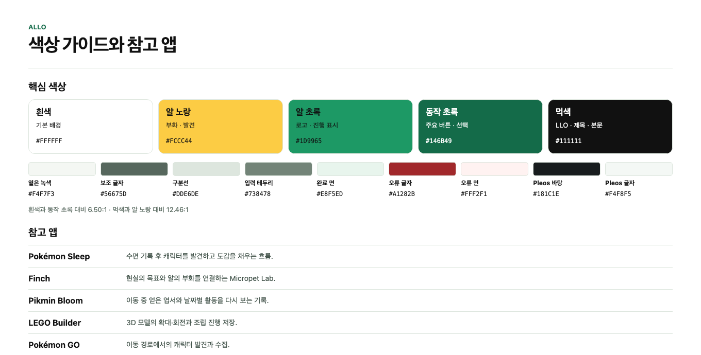

# 알로 색상 가이드와 참고 앱

## 색상 가이드

| 색 | HEX | 쓰는 곳 |
|---|---|---|
| 흰색 | `#FFFFFF` | 폰 화면의 기본 면, 어두운 버튼의 글자 |
| 알 노랑 | `#FCCC44` | 윗껍질, 부화, 새 친구 라벨처럼 발견에 해당하는 순간 |
| 알 초록 | `#1D9965` | 로고 몸체, 진행바와 성장 표시 |
| 동작 초록 | `#146B49` | `감싸기`, `봤어!` 등 다음 행동과 선택된 탭 |
| 먹색 | `#111111` | 검은 LLO, 제목, 본문, 노란 라벨 위 글자 |
| 옅은 녹색 면 | `#F4F7F3` | 알과 캐릭터 뒤의 조용한 면, 필터와 구역 분리 |
| 보조 글자 | `#56675D` | 남은 시간의 설명, 환경, 보조 문구 |
| 구분선 / 입력 테두리 | `#DDE6DE` / `#738478` | 구획을 나누는 얇은 선 / 흰 입력칸의 식별 경계 |
| 완료 면 | `#E8F5ED` | 연결 확인과 완료 상태에 동작 초록 글자·아이콘을 곁들임 |
| 오류 글자 / 면 | `#A1282B` / `#FFF2F1` | 연결 코드 오류나 재연결이 필요한 상태 |
| Pleos 바탕 / 글자 | `#181C1E` / `#F4F8F5` | 정차 중 앱 창 안에서 큰 글자와 필요한 상태만 표시 |

흰색 글자와 동작 초록의 대비는 **6.50:1**, 먹색 글자와 알 노랑은 **12.46:1**이다. 흰색과 알 초록의 조합은 **3.62:1**이므로 작은 버튼 글자에는 동작 초록을 쓴다. [W3C 텍스트 대비 기준](https://www.w3.org/WAI/WCAG22/Understanding/contrast-minimum.html)

## 참고 앱

| 앱 | 참고 기능 |
|---|---|
| Pokémon Sleep | 수면 기록 후 캐릭터를 발견하고 도감을 채우는 흐름. [공식 게임 소개](https://www.pokemonsleep.net/en/pokemon/) |
| Finch | 현실의 목표와 알의 부화를 연결하는 Micropet Lab. [공식 도움말](https://help.finchcare.com/hc/en-us/articles/37780505907469-Using-the-Micropet-Lab) |
| Pikmin Bloom | 이동 중 얻은 엽서와 날짜별 활동을 다시 보는 기록. [공식 제품 소개](https://pikminbloom.com/en) · [Lifelog](https://scopelyexplore.helpshift.com/hc/en/11-pikmin-bloom/faq/2148-lifelog/) |
| LEGO Builder | 3D 모델의 확대·회전과 조립 진행 저장. [공식 기능 소개](https://www.lego.com/en-us/builder-app) |
| Pokémon GO | 이동 경로에서의 캐릭터 발견과 수집. [GO Wild Area 공식 소개](https://pokemongo.com/gowildarea/global) |
