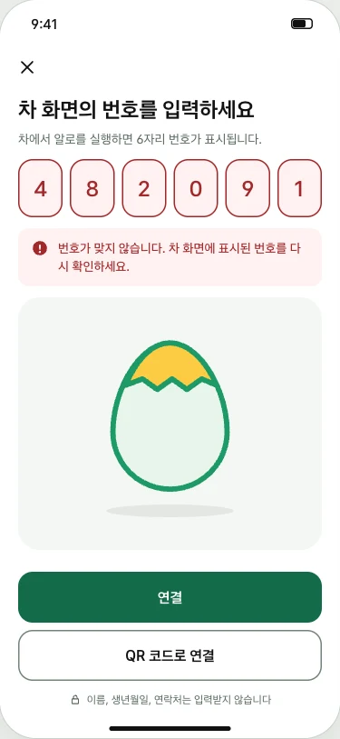
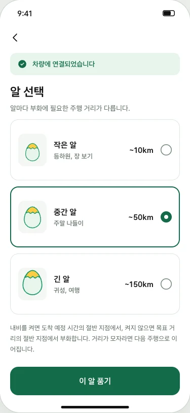
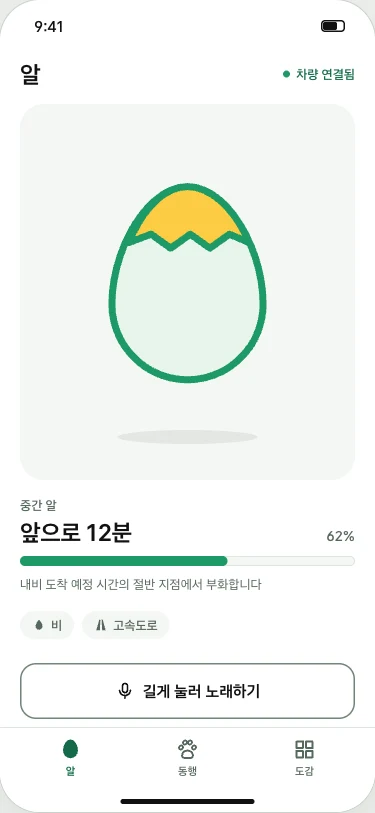
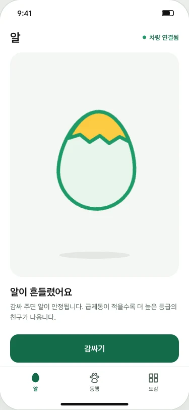
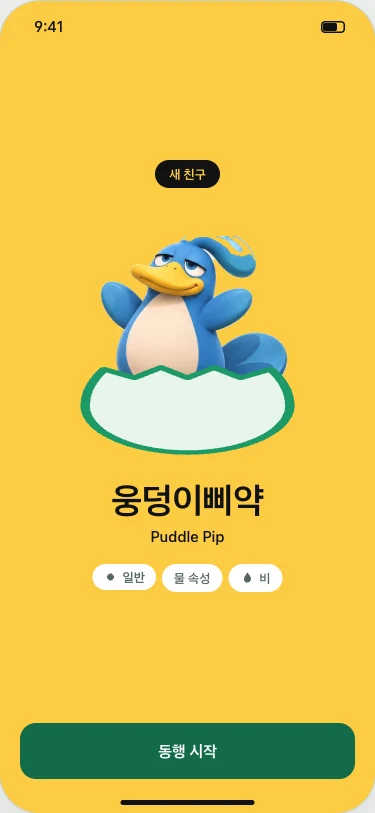
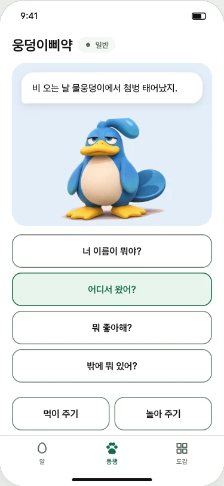
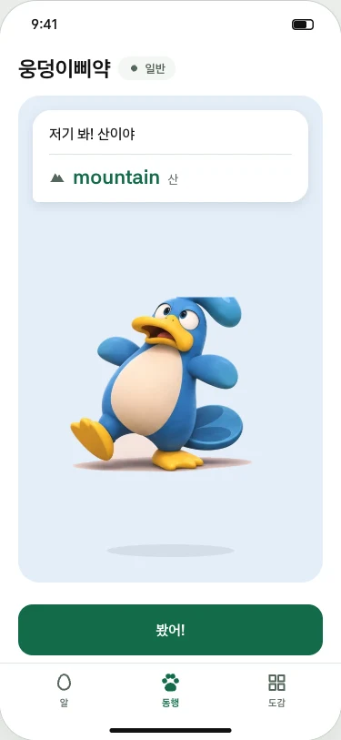
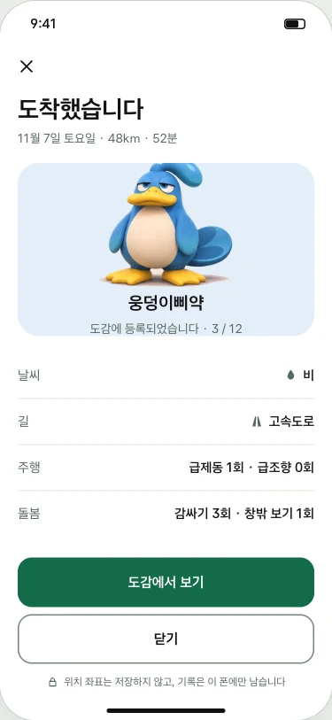
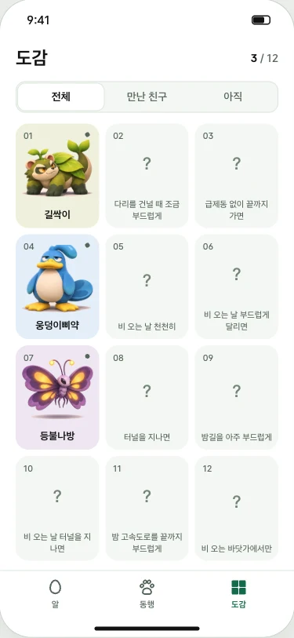
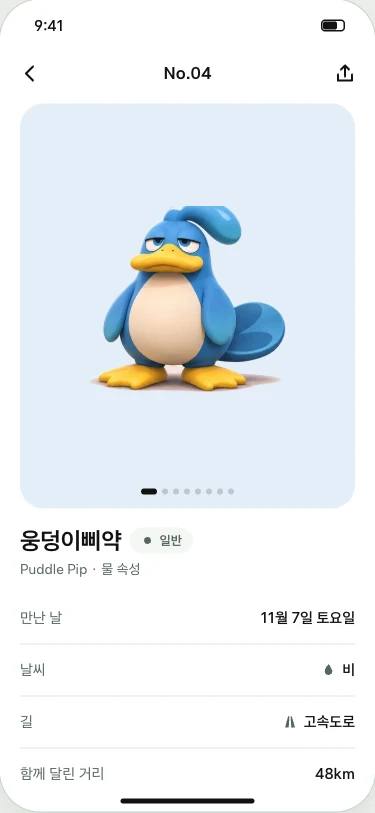

# 알로(ALLO) 디자인 시스템

> 2026-11-06 D(박찬) 작성 · v1
> 색은 확정안 「색상 및 참고 서비스 가이드」(2026-11-06), 캐릭터는 `character-production-01`(2026-11-05 승인 12종)을 기준으로 한다.
> 토큰 원본: [`art/design/tokens.json`](../art/design/tokens.json) · 검사: `python3 scripts/check_design_tokens.py`
> Figma: [ALLO Design System](https://www.figma.com/design/TRrSfvlCajZCNcf8t9hK1u) (변수·스타일·컴포넌트, 캐릭터 시트)
> 와이어프레임: [`art/design/wireframes.html`](../art/design/wireframes.html) (브라우저로 연다. 폰 8화면 + 차 화면 4화면)

이 문서는 화면이 **어떻게 보이는지**만 정한다. 종 구성, 등급, 판정 규칙은 [`data/species.json`](../data/species.json)과 [`schema.md`](./schema.md)를 따른다.

## 1. 원칙

| 원칙 | 화면에서 지키는 방법 |
| --- | --- |
| 흰 면 위에 캐릭터가 주인공 | 바탕은 흰색. 알과 캐릭터 뒤에만 옅은 녹색 면을 깐다. 화면 장식으로 캐릭터와 경쟁하지 않는다 |
| 색마다 맡은 일이 하나 | 알 노랑은 발견, 알 초록은 성장, 동작 초록은 다음 행동이다. 다른 용도로 쓰지 않는다 |
| 색만으로 말하지 않는다 | 등급은 모양, 이름, 색을 함께 쓴다(8절). 환경 태그는 아이콘과 이름을 함께 쓴다 |
| 아이 손가락과 흔들리는 차 | 폰의 모든 버튼은 높이 56 한 가지, 차 화면은 76이다 |
| 멀미를 만들지 않는다 | 패럴랙스와 화면 전체 이동을 쓰지 않는다(10절) |
| 차 화면은 한눈에 | 주행 중에는 한 줄만 보여 준다. 버튼을 두지 않는다(9절) |

## 2. 색

### 2-1. 확정 팔레트

| 이름 | 토큰 | HEX | 쓰는 곳 |
| --- | --- | --- | --- |
| 흰색 | `color.white` | `#FFFFFF` | 폰 화면의 기본 면, 어두운 버튼의 글자 |
| 알 노랑 | `color.shell-yellow` | `#FCCC44` | 윗껍질, 부화, 새 친구 라벨처럼 발견하는 순간 |
| 알 초록 | `color.growth-green` | `#1D9965` | 로고 몸체, 진행바와 성장 표시 |
| 동작 초록 | `color.action-green` | `#146B49` | `감싸기`, `봤어!` 같은 다음 행동, 선택된 탭 |
| 먹색 | `color.ink` | `#111111` | 검은 LLO, 제목, 본문, 노란 라벨 위 글자 |
| 옅은 녹색 면 | `color.green-soft` | `#F4F7F3` | 알과 캐릭터 뒤의 조용한 면, 필터, 구역 분리 |
| 보조 글자 | `color.ink-muted` | `#56675D` | 남은 시간 설명, 환경, 보조 문구 |
| 구분선 | `color.line` | `#DDE6DE` | 구획을 나누는 얇은 선 |
| 입력 테두리 | `color.control-outline` | `#738478` | 흰 입력칸과 흰 버튼의 경계 |
| 완료 면 | `color.success-surface` | `#E8F5ED` | 연결 확인, 완료 상태. 동작 초록 글자와 함께 |
| 오류 글자 / 면 | `color.error-ink` / `color.error-surface` | `#A1282B` / `#FFF2F1` | 연결 코드 오류, 재연결 필요 |
| Pleos 바탕 / 글자 | `color.car-surface` / `color.car-ink` | `#181C1E` / `#F4F8F5` | 차 화면 |

가이드에 없어서 D가 정한 **파생값**은 세 개다. 바꾸려면 이 표를 같이 고친다.

| 토큰 | HEX | 이유 |
| --- | --- | --- |
| `color.action-green-pressed` | `#0E5137` | 동작 초록 버튼의 눌림 상태 |
| `color.shell-yellow-pressed` | `#E6B42C` | 알 노랑 버튼의 눌림 상태 |
| `color.logo-ground` | `#1E3A2F` | 로고 컬러판의 배경. 시안 이미지에서 뽑은 값 |

### 2-2. 역할 토큰

화면과 코드는 팔레트가 아니라 역할 토큰(`semantic.*`)을 쓴다. 전체 목록은 `tokens.json`에 있다.

| 역할 | 토큰 | 값 |
| --- | --- | --- |
| 바탕 | `bg.canvas` / `bg.soft` | 흰색 / 옅은 녹색 면 |
| 상태 면 | `bg.success` / `bg.error` / `bg.discovery` | 완료 면 / 오류 면 / 알 노랑 |
| 글자 | `text.primary` / `text.secondary` / `text.action` / `text.error` | 먹색 / 보조 글자 / 동작 초록 / 오류 글자 |
| 글자(반전) | `text.inverse` / `text.on-yellow` | 흰색(동작 초록 위) / 먹색(알 노랑 위) |
| 선 | `border.line` / `border.control` / `border.focus` | 구분선 / 입력 테두리 / 동작 초록 |
| 버튼 | `action.primary` / `action.discovery` / `action.secondary` | 동작 초록 / 알 노랑 / 흰색 + 입력 테두리 |
| 진행 | `progress.fill` / `progress.track` | 알 초록 / 옅은 녹색 면 + 구분선 외곽 |
| 차 화면 | `car.bg` / `car.text` / `car.progress` / `car.accent` | Pleos 바탕 / Pleos 글자 / 알 초록 / 알 노랑 |
| 로고 전용 | `brand.logo-yellow` / `brand.logo-mint` / `brand.logo-ground` | `#FFD34E` / `#58D8A0` / `#1E3A2F` |

### 2-3. 대비

`scripts/check_design_tokens.py`가 글자·배경 35쌍을 검사한다. 본문은 4.5:1, 큰 글자와 UI 요소는 3:1이 기준이다([WCAG 2.2](https://www.w3.org/WAI/WCAG22/Understanding/contrast-minimum.html)). 가이드에 적힌 수치 세 개도 같이 확인한다.

| 조합 | 대비 | 결과 |
| --- | --- | --- |
| 흰 글자 / 동작 초록 | 6.50:1 | 버튼 글자로 쓴다 |
| 먹색 글자 / 알 노랑 | 12.46:1 | 노란 라벨과 버튼 글자로 쓴다 |
| 흰 글자 / 알 초록 | 3.62:1 | **작은 글자에 쓰지 않는다.** 알 초록은 진행바와 로고에만 |
| 알 초록 채움 / 옅은 녹색 트랙 | 3.35:1 | 진행바. 트랙을 구분선 색으로 칠하면 2.84:1로 떨어져서 바꿨다 |
| 입력 테두리 / 흰색 | 3.96:1 | 흰 버튼과 입력칸의 경계 |
| 알 초록 / Pleos 바탕 | 4.74:1 | 차 화면 진행바 |

## 3. 캐릭터

### 3-1. 표현

- 단단한 스타일라이즈드 3D, 절제된 셀 셰이딩과 부드러운 그림자. 기준은 `character-production-01`의 시트 24장이다(종별 8방향 1장, 동작 6포즈 1장)
- 동작 6포즈: IDLE, MOVE, HAPPY, SURPRISED, SAD, SLEEP. 앱 상태와의 대응은 3-3절에 둔다
- 화면에서는 캐릭터 뒤에 `bg.soft`나 종별 `tint`를 깐다. 캐릭터 위에 글자를 겹치지 않는다

### 3-2. 12종과 시그니처 색

시그니처 색은 8방향 시트의 정면 컷에서 뽑아 UI용으로 다듬었다. **그 종 옆에서만 쓴다.** 앱 크롬(버튼, 탭, 진행바)에는 쓰지 않는다.

| | id | 이름 | base | deep | accent | tint | species.json |
| --- | --- | --- | --- | --- | --- | --- | --- |
| A | `road_sprout` | Road Sprout · 길싹이 | `#7F9140` | `#4E5A28` | `#F0A93A` | `#EEF0DC` | tier 1, 조건 없음 |
| B | `puddle_pip` | Puddle Pip · 웅덩이삐약 | `#4A90D0` | `#2D5D8E` | `#F4BE4A` | `#E3EEF8` | tier 1, rain |
| C | `lamp_moth` | Lamp Moth · 등불나방 | `#9364A8` | `#5B3767` | `#FAD26A` | `#EFE6F2` | tier 1, night |
| D | `storm_lantern` | Storm Lantern · 폭풍등 | `#F4C03C` | `#5A5560` | `#FFE27A` | `#FCF1D6` | tier 3, rain + tunnel |
| E | `highway_comet` | Highway Comet · 고속혜성 | `#F0814E` | `#A9502C` | `#FBD3A6` | `#FCE6DC` | tier 3, highway + night |
| F | `sea_mist` | Sea Mist · 바다안개 | `#A9DCDA` | `#4F8790` | `#C7B6E8` | `#EAF5F4` | tier 3, coast + rain |
| G | `ember_crab` | Ember Crab | `#A2333F` | `#6B2328` | `#F2A066` | `#F4E0DF` | **없음** |
| H | `dewcap` | Dewcap | `#EE7A86` | `#B84A5A` | `#FBC2BC` | `#FCE6E6` | **없음** |
| I | `cloud_strider` | Cloud Strider | `#EFE4DF` | `#5C4554` | `#A8A0A6` | `#F6F0EE` | **없음** |
| J | `pebble_orbit` | Pebble Orbit | `#5E5554` | `#393232` | `#F3E3C4` | `#E9E3E1` | **없음** |
| K | `breeze_wyrm` | Breeze Wyrm | `#79B5E6` | `#4A7CB2` | `#E6F2FC` | `#E6F0F9` | **없음** |
| L | `dune_roller` | Dune Roller | `#C8734A` | `#6E3D25` | `#F1C79E` | `#F6E4DA` | **없음** |

- `base`는 몸 색, `deep`은 그림자와 외곽, `accent`는 반복되는 특징(눈, 빛, 점), `tint`는 도감 카드 바탕이다
- `tint` 위 먹색 글자는 12종 모두 14.8:1 이상이다(검사 스크립트 포함)

> **C 확인 필요.** G~L 6종은 `data/species.json`에 없고, 대신 다리뛰기·산정령·강미끄럼·물결지기·터널나방·별부엉이 6종이 들어 있다. 물결지기는 시연에서 부화하는 종이다. 새 6종의 한글 이름, 등급, 출현 조건은 C가 정한다. 그전까지 도감 화면은 A~F만 실제 데이터로 그린다.

### 3-3. 동작 포즈와 앱 상태

| 포즈 | 쓰는 화면 |
| --- | --- |
| IDLE | 도감 카드, 동행 화면의 기본 상태 |
| MOVE | 동행 화면에서 차가 달릴 때 |
| HAPPY | 부화 직후, 먹이 주기·놀아 주기 후 |
| SURPRISED | 급제동·급조향 직후, 창밖 보기 프롬프트 |
| SAD | 쓰지 않는다. 방치해도 벌을 주지 않는다는 원칙 때문이다. 쓰려면 회복 행동이 바로 붙는 상황만 허용한다 |
| SLEEP | 정차가 길 때, 앱을 다시 열었을 때 |

창밖을 가리키는 `look` 포즈가 시트에 없다. 창밖 보기는 앱의 핵심 장면이라 포즈 추가를 요청한다. 그전까지는 SURPRISED로 대신한다.

## 4. 글자

한 가족만 쓴다. **Asta Sans**(Google Fonts, OFL)이다. Pleos Connect 시스템 UI에 들어가는 글꼴이고 한글과 영문을 함께 지원한다. 차 화면과 폰의 글자 인상을 맞추려고 골랐다. 둥글고 굵은 인상은 로고가 맡고, 화면 글자는 조용하게 둔다.

| 스타일 | 굵기 / 크기 / 줄 높이 | 쓰는 곳 |
| --- | --- | --- |
| `display-xl` | 700 / 36 / 44 | 부화한 생물 이름 |
| `display-lg` | 700 / 28 / 36 | 화면 제목 |
| `title-md` | 700 / 20 / 28 | 종 이름, 카드 제목 |
| `label-lg` | 700 / 20 / 26 | 큰 버튼 |
| `label-md` | 700 / 16 / 22 | 중간 버튼, 배지, 칩 |
| `word-en` | 700 / 24 / 30 | 창밖 보기의 영어 단어 |
| `body-lg` | 500 / 18 / 28 | 생물 대사, 아이가 읽는 글 |
| `body-md` | 400 / 16 / 24 | 도감 상세, 보호자가 읽는 글 |
| `caption` | 500 / 13 / 18 | 날짜, 장소, 날씨 |
| `car-status` | 700 / 28 / 36 | 차 화면 주행 중 한 줄 |
| `car-title` | 800 / 48 / 56 | 차 화면 정차 중 제목 (Pleos Headline Small) |

- 아이가 읽는 글은 18 이상을 쓴다. 13 캡션은 보호자용 메타데이터에만 쓴다
- 대사는 50자 이내(`scripts/validate_dialogue.py`)라 말풍선이 3줄을 넘지 않는다

## 5. 간격·모서리·크기

| 토큰 | 값 |
| --- | --- |
| `spacing` | xxs 4 · xs 8 · sm 12 · md 16 · lg 24 · xl 32 · 2xl 48 · 3xl 64 |
| `radius` | sm 8 · md 12 · lg 16 · xl 24 · full 999 |
| `size.touch-min` | 56. 폰의 모든 버튼과 최소 터치 영역 |
| `size.touch-car` | 76. 차 화면(Android for Cars 최소 기준) |
| `size.border` / `size.border-control` | 1 / 2 |
| `shadow.raised` | 0 4 12, 먹색 10%. 말풍선에만 쓴다 |

모서리는 위계를 따른다. 화면 안 큰 카드는 24, 버튼과 시트 행은 16, 작은 면은 12, 칩과 배지는 원형이다.

## 6. 아이콘

24 격자다. 환경 태그, 등급, 경고처럼 의미를 나르는 아이콘은 채운 모양이고, 뒤로·닫기·탭·더보기 같은 시스템 아이콘은 2px 선(둥근 끝)이다. 선택된 탭만 채운다. Figma `Icons` 섹션에 컴포넌트로 있다.

- 환경 태그 7개: `rain` 물방울, `night` 달, `tunnel` 아치, `highway` 길, `coast` 물결, `mountain` 산, `city` 건물
- 등급 4개: 원, 마름모, 별, 반짝임(8절)
- UI: 알, 친구(발자국), 도감(격자), 경고

색은 쓰는 곳에서 역할 토큰으로 덮어쓴다.

## 7. 컴포넌트

Figma `Components` 페이지에 있다. 모든 색, 간격, 모서리는 변수에 묶여 있다.

| 컴포넌트 | 변형 | 규칙 |
| --- | --- | --- |
| **Button** | Style 3 × State 3 = 9 | 높이는 56 하나다. Primary(동작 초록)는 다음 행동, Discovery(알 노랑)는 발견하는 순간에만 쓴다. Secondary는 흰색 + 입력 테두리이고, 선택된 상태는 완료 면 + 동작 초록 테두리다. 폭은 가로 전체이고 한 줄에 하나씩 쌓는다(예외: 먹이 주기·놀아 주기처럼 짝인 두 개는 반폭). 한 화면의 하단 버튼은 최대 둘이고 Primary나 Discovery는 하나만 둔다. 글자만 있는 Ghost 버튼은 쓰지 않는다 |
| **Tier Badge** | Common · Rare · Epic · Special | 8절 |
| **Tag Chip** | 환경 태그 7 | 옅은 녹색 면 + 보조 글자 한 가지 스타일. 아이콘이 의미를 맡는다. 누를 수 없다 |
| **Egg Progress** | Early · Mid · Ready | 끝이 보이는 진행바. 남은 양은 말로 쓴다("앞으로 12분", "앞으로 8km"). 퍼센트와 상황 설명은 보조 글자다 |
| **Speech Bubble** | Dialogue · Look | 생물 대사. Look은 영어 단어 한 개를 동작 초록으로 보여 주고 `봤어!` 버튼과 짝을 이룬다. 각진 왼쪽 아래 모서리가 생물을 가리킨다 |
| **Status Banner** | Success · Error | 페어링과 연결 상태. 오류는 무엇이 틀렸고 무엇을 하면 되는지 쓴다. 사과하지 않는다 |
| **Car Status** | Incubating · Hatched | 차 화면 주행 중 한 줄(9절) |

다음 컴포넌트는 와이어프레임 단계에서 만든다: **Tab Bar**(알 · 친구 · 도감, 선택된 탭은 동작 초록), **Dex Card**(수집 / 미수집, 초상 이미지 교체 속성).

## 8. 등급 표현

희소도는 모양, 이름, 색을 항상 함께 쓴다. 색만 다른 배지는 만들지 않는다.

| 배지 | 모양 | 이름 | 색 | 대응 (C 확정 필요) |
| --- | --- | --- | --- | --- |
| Common | ● | 일반 | 옅은 녹색 면 / 보조 글자 | tier 1 |
| Rare | ◆ | 희귀 | 완료 면 / 동작 초록 | tier 2 |
| Epic | ★ | 초희귀 | 동작 초록 / 흰색 | tier 3 |
| Special | ✦ | 특별 | 알 노랑 / 먹색 | 복합 조건 희귀종 |

등급이 높다고 캐릭터 그림에 효과를 덧칠하지 않는다. 차이는 배지와 부화 연출(알 노랑의 양)로 낸다. 확률형 연출(룰렛, 카드 뒤집기)은 쓰지 않는다.

## 9. 차 화면 (Pleos)

| 상태 | 화면 |
| --- | --- |
| 주행 중 (`CarUxRestrictions` 활성) | `Car Status` 한 줄만 보여 준다. 아이콘, 문장, 작은 진행바로 구성하고 버튼은 없다. 2초 안에 읽혀야 한다 |
| 정차 중 (기어 P) | Pleos 바탕에 `car-title` 48과 필요한 상태만 보여 준다. 터치 영역은 76이다 |
| 기어 D 진입 | 즉시 주행 화면으로 돌아간다. 전환 애니메이션은 페이드 200ms 하나만 쓴다 |

## 10. 모션

| 토큰 | 값 | 쓰는 곳 |
| --- | --- | --- |
| `duration.fast` | 120ms | 버튼 눌림 |
| `duration.base` | 200ms | 화면 안 요소 등장, 차 화면 전환 |
| `duration.slow` | 360ms | 시트 열기 |
| `duration.hatch` | 2400ms | 부화 연출 한 번 |
| `easing.standard` | `cubic-bezier(.2,.8,.2,1)` | 전부 |

- 패럴랙스, 화면 전체 슬라이드, 흔들리는 배경을 쓰지 않는다(멀미)
- 알 흔들림은 알 자체만 작게 움직인다. 화면은 움직이지 않는다
- 기기에서 동작 줄이기를 켜면 움직임을 페이드로 바꾼다

## 11. 로고

- 알 껍질이 갈라진 A와 둥근 LLO로 구성된다. 수정안은 LLO를 왼쪽으로 당겨 A와 첫 L 사이를 좁혔다
- 컬러판: 윗껍질 `#FFD34E`, A 몸체 `#58D8A0`, LLO `#FFFFFF`, 배경 `#1E3A2F`
- 단색판: 먹색 `#111111` 한 가지다. 시안에서 144 / 96 / 64px 크기를 확인했다. 64px보다 작은 크기는 아직 정하지 않았다
- 로고 색(`brand.*`)은 UI에 쓰지 않는다. 화면의 초록은 알 초록과 동작 초록이다
- **원본 벡터 파일이 레포에 없다.** SVG를 받으면 `art/design/logo/`에 넣는다

## 12. 참고 앱

| 앱 | 가져올 것 | 알로 화면 |
| --- | --- | --- |
| [Pokémon Sleep](https://www.pokemonsleep.net/en/pokemon/) | 기록이 끝나면 캐릭터를 발견하고 도감을 채우는 흐름 | 도착 → 도감 등록 |
| [Finch](https://help.finchcare.com/hc/en-us/articles/37780505907469-Using-the-Micropet-Lab) | 현실의 목표와 알 부화를 잇는 Micropet Lab | 품기 화면 |
| [Pikmin Bloom](https://pikminbloom.com/en) | 이동 중 얻은 엽서, 날짜별 활동 기록([Lifelog](https://scopelyexplore.helpshift.com/hc/en/11-pikmin-bloom/faq/2148-lifelog/)) | 도감 상세의 획득 날짜·장소·날씨 |
| [LEGO Builder](https://www.lego.com/en-us/builder-app) | 3D 모델의 확대·회전, 진행 저장 | 도감 상세의 8방향 보기 |
| [Pokémon GO](https://pokemongo.com/gowildarea/global) | 이동 경로에서 캐릭터를 발견하고 수집하기 | 지역 수집 |

## 13. 열린 결정

| 항목 | 담당 | 내용 |
| --- | --- | --- |
| G~L 6종 데이터 | C | `species.json`에 넣을지, 기존 6종과 어떻게 바꿀지. 시연 부화 종(물결지기) 포함 |
| 등급 대응 | C | 8절 표의 tier 대응 확인 |
| look 포즈 | D | 12종 창밖 보기 포즈 추가 생성 |
| Flutter 테마 | B | `phone/lib/app.dart`의 `colorSchemeSeed: 0xFF4FB3A9`를 이 토큰으로 교체. Asta Sans 번들 |
| 로고 원본 | D | SVG 받아서 `art/design/logo/`에 추가 |
| 캐릭터 이미지 | 전원 | 시트 24장의 레포 반입 여부(생성 도구 라이선스 확인 후). 지금은 Figma에만 있다 |

## 화면 미리보기

와이어프레임 v4 정상 흐름의 폰 화면이다. 전체 35화면 이미지는 [`art/design/preview/`](../art/design/preview/)에 번호순으로 있고, 원본은 [`wireframes.html`](../art/design/wireframes.html)이다. 화면을 고치면 이미지도 다시 뽑는다.

| 1. 연결 | 2. 알 선택 | 3. 품기 | 4. 감싸기 |
| --- | --- | --- | --- |
|  |  |  |  |

| 5. 부화 | 6. 동행·물어보기 | 7. 창밖 보기 | 8. 도착 |
| --- | --- | --- | --- |
|  |  |  |  |

| 9. 도감 | 10. 도감 상세 |
| --- | --- |
|  |  |

차 화면은 [`11.webp`](../art/design/preview/11.webp)~[`15.webp`](../art/design/preview/15.webp)에 있다.
