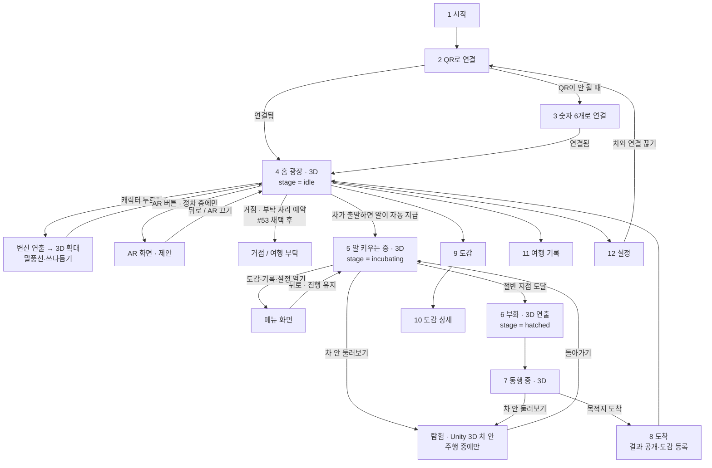

# ALLO 폰 앱 유저 플로우 (3D 장난감 세계)

목업: `mockups/allo-flow.html` (왼쪽 패널에서 화면·시간대·상태를 바로 바꿈). 상태 기준은 `docs/schema.md` §3.4 `game`, 화면 기준은 `docs/roadmap.md` B-3.

## 1. 한 줄 요약

12개 화면과 확대·AR 모두 3D 장난감 스타일로 통일했다. 홈은 고속도로 휴게소 위 3D 광장이고, 캐릭터를 누르면 그 자리에서 화면 가운데로 튀어 오르며 커진다("변신 연출"). 시간대(아침·낮·저녁·밤)는 기기 시계를 따르며 시각 표현만 바꾼다.

## 2. 큰 흐름

재탑승 시에는 저장된 `sessionId`로 자동 재연결하므로 시작에서 홈으로 바로 간다(`roadmap.md` B-2). 연결이 끊기면 홈 왼쪽 위 연결 표시가 노란색으로 바뀐다.

## 2-1. 정차 중과 주행 중의 역할 (결정 2026-11-10)

| 구분 | 화면 | 이유 |
| --- | --- | --- |
| 정차 중(출발 전, 도착 후) | 홈(광장), AR, 예약된 거점·부탁 | 걸어 다니는 광장과 카메라는 정차 중에만 |
| 주행 중 | 5 알 키우는 중, 6 부화, 7 동행 중, **탐험**(Unity 차 안·밖). 도감·기록·설정도 5·7에서 열 수 있음 | 차가 출발하면 홈에서 5로 자동 이동. 메뉴에서 뒤로 가면 5·7의 진행이 유지됨 |

- 탐험은 `dev`에 이미 구현된 Unity 화면(A 담당)이고 5·7의 "차 안 둘러보기"에서 들어간다. 이 목업은 탐험 화면을 새로 그리지 않는다.
- **결정(2026-11-10): 주행 중에도 도감·기록·설정을 열 수 있다.** 5·7 화면 왼쪽 아래의 작은 버튼 3개로 연다. art-direction 초안(`docs/art-direction` 브랜치, 미병합)의 "조작이 많은 화면은 정차 후" 취지와 부딪힐 수 있어 팀 확인이 필요하다.
- 홈에는 주행 상태 표현이 없다(캡슐은 항상 "알 기다리는 중"). 홈의 "차 출발"은 5로 가는 목업용 버튼이다.

## 3. 화면 목록

| # | 화면 | 표현 | 들어오는 조건 | 보여 주는 것 | 나가는 곳 |
| --- | --- | --- | --- | --- | --- |
| 1 | 시작 | 3D | 앱 실행 | 로고(ALLO, O는 알), 캐릭터 2마리, "화면을 눌러 시작" | 2, 저장된 연결이 있으면 4 |
| 2 | QR로 연결 | 3D | 처음 또는 연결 끊김 | QR 비추는 칸, "숫자로 연결하기" | 4, 3 |
| 3 | 숫자로 연결 | 3D | QR이 안 될 때 | 6칸 입력, 숫자 키패드, 지우기, 연결하기 | 4 |
| 4 | 홈(광장) | 3D | `idle`(정차) 또는 도착 직후. 기본 화면 | 3D 광장에서 돌아다니는 친구들(밤엔 잠), 인큐베이터 캡슐, 도감, 기록, 설정, AR, 거점·부탁 예약 자리, 연결 상태 | 9, 11, 12, 확대, AR, 차 출발 시 5 |
| 5 | 알 키우는 중 | 3D | `incubating` | 흔들리는 알, 10칸 진행 막대, "앞으로 N분", 메뉴 버튼 3개, "차 안 둘러보기" | 6, 9, 11, 12, 탐험 |
| 6 | 부화 | 3D | 진행도 1 | 흔들림 → 균열 → 번쩍 → 껍질 파편 → 캐릭터 등장, 이름·등급 | 7 |
| 7 | 동행 중 | 3D | `hatched` | 흔들리는 캐릭터와 한마디, 진행 막대, 메뉴 버튼 3개, "차 안 둘러보기" | 8, 9, 11, 12, 탐험 |
| 8 | 도착 | 3D | 목적지 도착 | 이번에 만난 친구, "도감에 담았어요" | 4 |
| 9 | 도감 | 3D | 홈에서 | 12칸, 못 만난 친구는 실루엣, 수집 수 | 10 |
| 10 | 도감 상세 | 3D | 도감에서 | 큰 그림, 이름, 등급, 기본/기쁨/잠 포즈 | 9 |
| 11 | 여행 기록 | 3D | 홈에서 | 날짜, 길, 만난 친구 | 4 |
| 12 | 설정 | 3D | 홈에서 | 효과음, 배경음, 차와 연결 끊기 | 4, 2 |
| - | 변신 확대 | 3D 층 | 홈에서 캐릭터 누름 | 흐린 배경 위로 캐릭터가 튀어 오르며 확대, 별 터짐, 이름·등급, 말풍선, 쓰다듬기(하트) | 4 |
| - | AR | 3D 층 | 홈의 AR 버튼 (정차 중만) | 카메라 화면에 캐릭터, 사진 찍기 | 4 |

### 홈의 예약 자리 (#53 채택 전)

`docs/feature-rework-spec.md`(PR #53)의 거점과 여행 부탁은 폰 홈에서 열린다고 되어 있다. 채택이 정해지기 전이라 자리만 잡아 둔다.
- 거점 진입: 홈 왼쪽 아래 도감 옆의 점선 회색 버튼(누르면 "준비 중" 안내).
- 여행 부탁 알림: AR 버튼 아래 작은 배지. 부탁이 없으면 보이지 않는다(왼쪽 패널에서 켜고 끔).
- 자리가 비어 있을 때 레이아웃이 어색하지 않아야 한다. 채택되면 이 문서와 화면을 같이 고친다.

### 홈 상태 변형
- 차 연결: 연결됨 / 끊김(노란 표시).
- 여행: 정차만 있다(캡슐에 "알 기다리는 중"). 주행이 시작되면 홈이 아니라 5번 화면이 보인다.
- 여행 부탁: 없음 / 있음(배지).
- 친구 수: 0, 4, 8, 12 마리.
- 시간대: 아침 / 낮 / 저녁 / 밤(기기 시계 자동, 패널에서 고정 가능). 밤에는 친구들이 잠들고 가로등이 켜진다.

## 4. 표현 규칙

**공통**
- 글자는 픽셀체를 쓰지 않는다. 제목·버튼은 Do Hyeon, 본문은 Noto Sans KR. 글자는 버튼 안에서 가로·세로 중앙(오차 1px 이내).
- 색: 남색 외곽선 `#2A2D48`, 크림 `#FFF6DC`(순백 대신), 안내 초록, 의무 파랑, 강조 노랑.
- 진행은 거리나 시간만 보여 준다. 점수, 체력, 랭킹, 연속 접속, 실패 표시는 없다.
- 결과(새 친구, 도감 등록)는 도착 화면에서 공개한다. 아이 개인정보 입력란은 없다. 입력은 차 화면의 6자리 숫자뿐이다.

**홈(3D 광장)**
- 배경: 시간대별 하늘, 먼 도시, 고속도로 위를 지나가는 장난감 차, 가운데 아이소 플랫폼(두꺼운 밑면, 체커 바닥, 가로등, P 표지, 콘), 양옆 나무. "내 차"는 그리지 않는다.
- 캐릭터는 3D 이미지(기본·걷기·잠 포즈), 바닥 그림자, 걸을 때 통통 뛴다.

**전체 3D 규칙**
- 둥근 모서리(18~26px), 굵은 남색 테두리(3.5~4px), 아래로 두껍게 나온 밑면, 누르면 4px 가라앉는다. 판은 탄성 있게 튀어 열린다.
- 홈 밖 화면은 같은 배경을 흐리게 처리해 쓴다(플랫폼은 숨김). 화면 전용 3D 배경은 나중에 따로 만든다.

**변신 연출(홈 → 확대)**: 번쩍 → 배경이 흐려지며 캐릭터가 광장 위치에서 가운데로 탄성 있게 커짐 → 기쁨 포즈로 바뀌며 별 8개 → 이름표·말풍선 등장. 화면을 누르면 하트.

**부화 연출(약 4초)**: 흔들림 3단계 + 균열 3개 + 점점 밝아지는 빛 → 번쩍과 충격파, 껍질 파편 16개, 별 → 캐릭터가 튀어나오고 빛줄기가 돎 → 배너, 이름표, 버튼 순서로 등장. 컨페티는 쓰지 않는다.

## 5. 결정이 필요한 것

| 항목 | 현재 문서 | 충돌하는 방향 | 목업 처리 |
| --- | --- | --- | --- |
| AR 전환 | 문서·`dev` 코드 어디에도 없음. 다른 팀원이 작업 중이고 커밋은 아직 올라오지 않음 | 카메라는 QR 연결에만 쓰고 프레임을 저장하지 않는다는 약속 | 제안용 버튼. 정차 중에만 켜짐. 커밋이 올라오면 그 구현에 맞춰 수정 |
| 주행 중 홈 | 주행 중에는 5·7 화면을 보여 줌 | 홈에 주행 상태 표현 | **결정(2026-11-10): 차가 출발하면 5(알 키우는 중)로 넘어간다.** 목업 홈에서 주행 상태 표현을 지움 |
| 주행 중 메뉴 | 도감은 "정차 후"(art-direction 초안(`docs/art-direction` 브랜치, 미병합)) | 5·7에서 도감·기록·설정 허용 | **결정(2026-11-10): 열 수 있게 한다.** 팀 확인 필요 |
| 홈 화면 라우트 | `dev` 앱은 `/pairing`에서 시작, 시작·홈·기록·설정 화면 없음 | 목업은 12화면 | 구현 시 새 화면과 라우트 필요 |
| 12종 종 ID | `dev` `species.json` 12종, 뒤 6종 이름이 다름 | 목업은 Ember Crab 등 | #53 D12 결정 대기 |
| 거점·여행 부탁·낚시(#53) | 문서만 있고 `dev`에 없음 | 목업은 자리만 | 채택 후 화면 추가 |
| 시간대 | `schema.md` `envTags`의 `night`는 차량이 Asia/Seoul 19:00~06:00로 산출 | 새벽·낮·저녁은 계약에 없음 | **결정: 기기 시계 사용, 시각 표현만.** 밤 경계는 계약과 같은 19:00 이후로 맞추는 것을 제안 |
| 밤에 잠든 친구 | 없음 | 낮밤이 게임 상태에 영향을 주면 안 됨 | **결정: 시각 표현만** |
| 알 도망 | 품는 시간 전에 그만두면 도망 | "실패 페널티 없음" | 넣지 않음 |
| 급제동·급조향 판정과 "감싸기" | `schema.md` `harshBrake`, `roadmap.md` B-3 | "운전 평가 없음" (C 승인 필요) | 넣지 않음 |
| 주행 중 부화 | 절반 지점에서 부화(5→6) | "결과는 도착 후" | 흐름은 문서대로 두고 6에서 공개 |
| 창밖 보기, 영어 단어 | `roadmap.md` 동행 화면 | "주행 중 조작 없음" | 한마디만 표시 |
| 친밀도 | 가이드 | `schema.md`에 없음 | 표시하지 않음 |
| 알 이미지 | 환경에 따라 무늬가 다름 | 크기별 이미지 없음 | 부화할 종의 알 이미지 하나를 사용 |
| 알 목표 거리 | `schema.md` 5/25/75km | `roadmap.md` C-3 10/50/150km | `schema.md`를 따름. C 확인 필요 |
| 뒤 6종 이름 | C 결정 대기 | 영문 표기 | 영문 그대로 |
| 구현 스택 | 폰 앱은 Flutter | 목업은 HTML | 목업은 시안일 뿐, 구현은 Flutter |

## 6. 목업의 예시 자료

여행 기록의 날짜, 도감 상세의 "처음 만난 날", 도감의 수집 목록(7/12)은 예시 값이다. 실제 값은 폰 로컬 도감(`DexStore`)에서 온다.

## 7. 이전 와이어프레임 v4에서 빠진 화면 (결정 필요)

이 문서가 와이어프레임 v4(PR #49, #85, 닫음)를 대체한다. v4에 있었으나 이번 흐름에 없는 화면이다. 필요하면 다시 그린다.

| 화면 | 이전 | 이번 | 메모 |
| --- | --- | --- | --- |
| 알 크기 선택(3종)과 품기 | 있음 | 없음(차 출발 시 알 자동 지급) | 알 크기는 코드에서 small로 고정, 목표 거리는 `schema.md` 5/25/75km |
| 감싸기 | 있음 | 없음 | 운전 평가 금지 원칙과 부딪힘, C 승인 필요 |
| 물어보기·창밖 보기("봤어!") | 있음 | "한마디" 표시만 | `dev`에는 구현됨 |
| 연결 오류·재연결 | 있음 | 연결 표시 노란색만 | 연결 코드 오류 상태 화면 필요 |
| 차 화면(Pleos) | 4화면+상태 | 범위 밖 | `design-system.md` 8-4 |

원본: `docs/design-refine` 브랜치의 `art/design/wireframes.html`, `art/design/preview/`.
