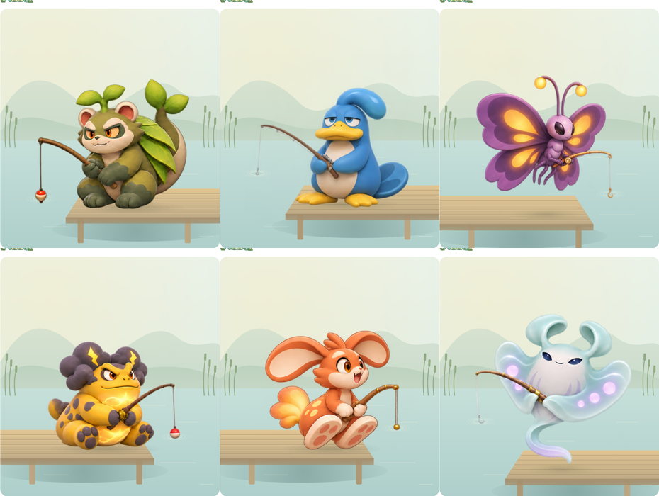

# 낚시 장면 6종 배치 검증

원본 낚시 시트(각 4×2, 8프레임)를 변경하지 않고 배경을 종별로 맞춘다. `FishingSceneProfile`은 원본 정사각형 안의 정규화 좌표로 낚시 방향, 몸 아래 그림자, 수면 접점을 정의한다. 배경과 캐릭터는 같은 애니메이션 시간을 사용하며 들어 올리기·포획·놓치기 프레임에는 수면 접점 물결을 표시하지 않는다.

| 캐릭터 | 낚시 방향 | 데크/그림자 |
|---|---|---|
| 길싹이 | 왼쪽 | 오른쪽 데크·접촉 그림자 |
| 웅덩이삐약 | 왼쪽 | 오른쪽 데크·발 위치 보정 |
| 등불나방 | 오른쪽 | 왼쪽 데크·공중형 그림자 |
| 폭풍등 | 오른쪽 | 왼쪽 데크·접촉 그림자 |
| 고속혜성 | 오른쪽 | 왼쪽 데크·발 위치 보정 |
| 바다안개 | 왼쪽 | 오른쪽 데크·공중형 그림자 |

## 재현

미리보기의 `fishingElapsedMs` 인텐트로 같은 프레임을 고정할 수 있다. 운영 앱에는 이 인텐트 처리가 없다. 프레임 0~7의 대표 시간은 각각 0, 900, 1200, 1500, 1800, 2100, 2400, 2700ms다.

```sh
adb -s emulator-5554 shell am start -S -n ai.allo.preview/.PreviewActivity --es screen Driving --es species lamp_moth --ez controls false --el fishingElapsedMs 0
```

앱 시작이 완료된 뒤 창 크기를 조정하고, 창 전환이 끝난 후 캡처한다. 원본 캡처는 로컬 `artifacts/fishing-six/`에 보관한다. 검증은 테스트 데이터 미리보기 기준이며 실제 차량/폰 연동을 뜻하지 않는다.

## 확인 결과 (2026-11-12)

- 6종 × 고유 프레임 8개 × 화면 2개 = 96개 고정 프레임을 촬영 후 육안 비교.
- 전체 1682×1210 라이트, 분할 841×1210 다크. 데크 방향·접촉/부유 그림자·수면 접점·낚싯줄/물고기 잘림 확인. 다른 창 크기나 실차 검증 완료를 뜻하지 않는다.
- 차량 테스트 293개 통과, app/preview debug 빌드 성공.



| 원본 종 ID | 전체 라이트 8프레임 | 분할 다크 8프레임 |
|---|---|---|
| road_sprout | [보기](screenshots/fishing-six/review-full-road_sprout.png) | [보기](screenshots/fishing-six/review-split-road_sprout.png) |
| puddle_pip | [보기](screenshots/fishing-six/review-full-puddle_pip.png) | [보기](screenshots/fishing-six/review-split-puddle_pip.png) |
| lamp_moth | [보기](screenshots/fishing-six/review-full-lamp_moth.png) | [보기](screenshots/fishing-six/review-split-lamp_moth.png) |
| storm_lantern | [보기](screenshots/fishing-six/review-full-storm_lantern.png) | [보기](screenshots/fishing-six/review-split-storm_lantern.png) |
| highway_comet | [보기](screenshots/fishing-six/review-full-highway_comet.png) | [보기](screenshots/fishing-six/review-split-highway_comet.png) |
| sea_mist | [보기](screenshots/fishing-six/review-full-sea_mist.png) | [보기](screenshots/fishing-six/review-split-sea_mist.png) |
