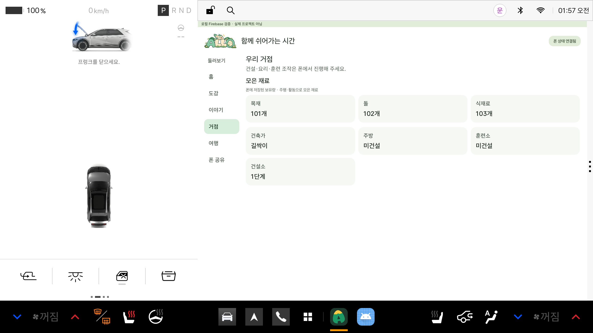
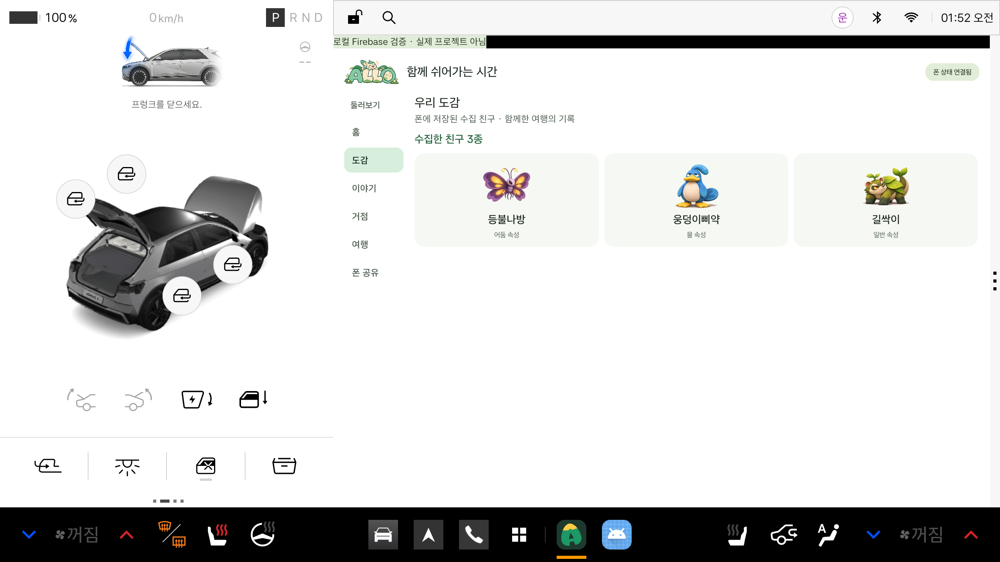
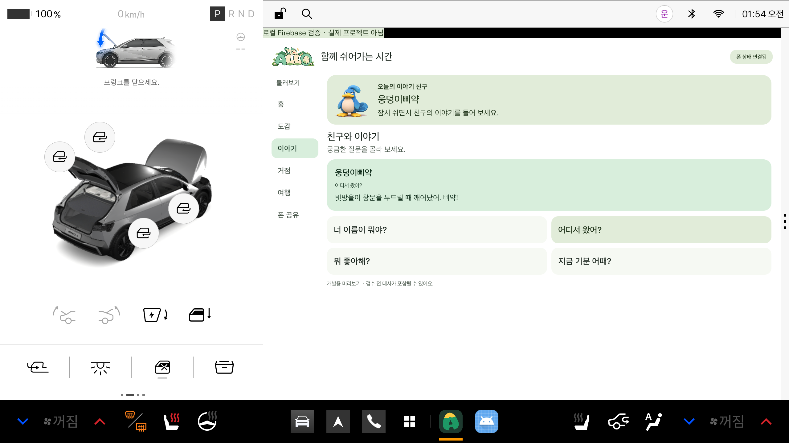
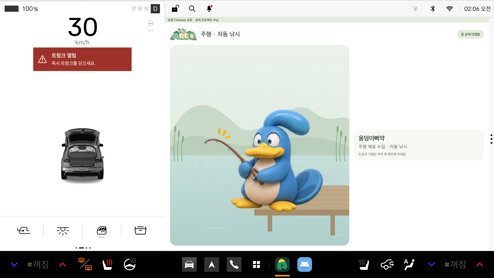
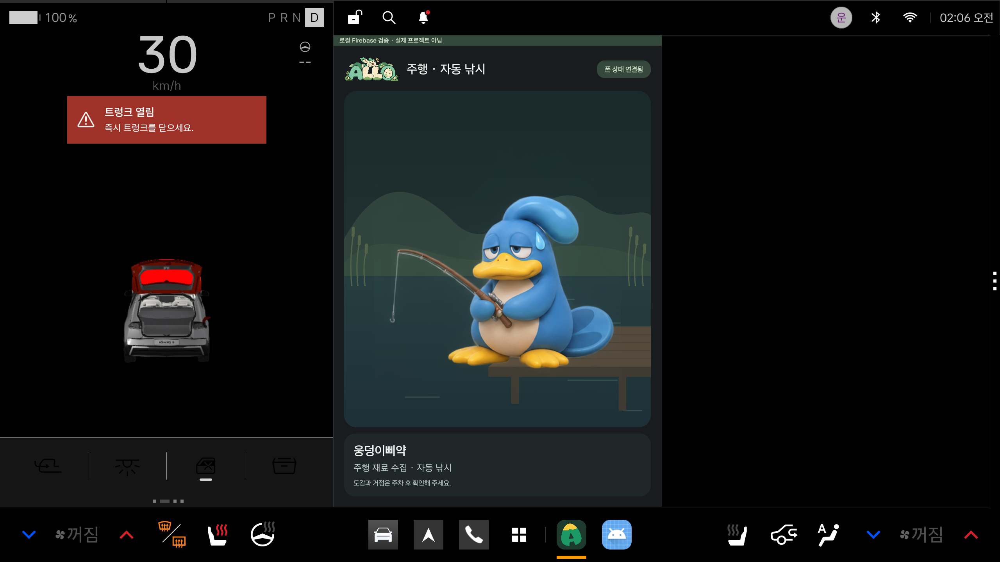
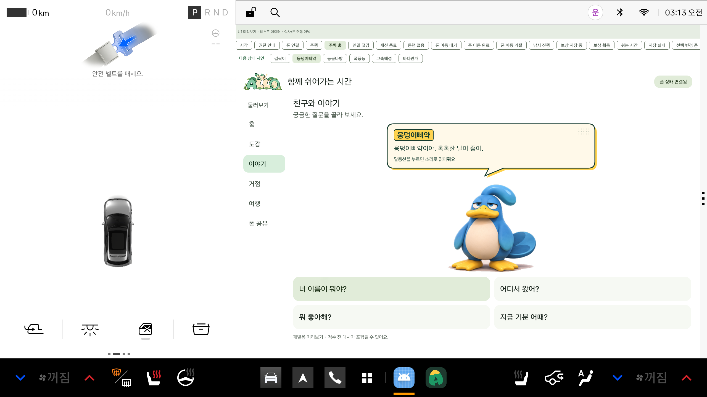
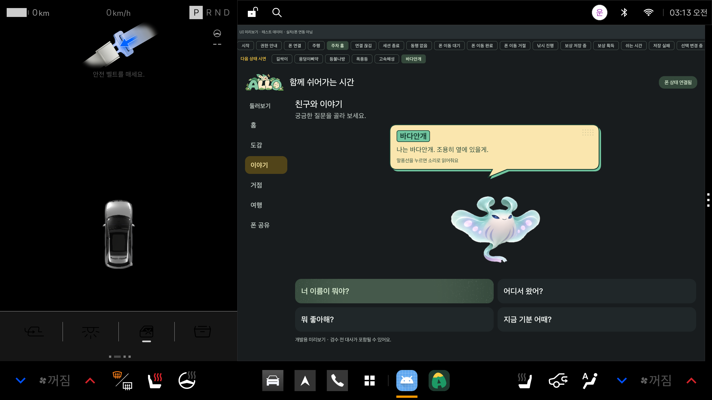

# 통합 화면 확인

Pleos 에뮬레이터와 로컬 Firebase에 연결된 앱 화면이다. 실제 프로젝트 배포·실차 검증을 뜻하지 않는다. 도감은 격리된 샘플 획득 기록, 재료·시설은 가상 주행 신호와 모바일 거점 조작으로 저장한 값이다.

| 홈 | 거점 |
|---|---|
|  |  |

| 도감 | 이야기 |
|---|---|
|  |  |

| 확대 낚시 · 라이트 | 분할 낚시 · 다크 |
|---|---|
|  |  |

도감/이야기 캡처는 동일 화면 디자인의 검증 과정에서 촬영해 debug 배너 간격이 최종 빌드와 약간 다르다. 사용자 로고와 캐릭터 원본은 유지한다. 주행 낚시 배경은 정적인 장식이며 실제 위치/날씨를 나타내지 않는다.

## 이야기 말풍선·TTS

아래는 테스트 데이터로 실행한 UI 미리보기다. 폰/실차 연동을 나타내지 않는다. 중앙 캐릭터와 팝아트 말풍선에 질문 답변을 표시하며, 말풍선을 눌러 Pleos TTS를 재생한다.

| 라이트 | 다크 |
|---|---|
|  |  |
